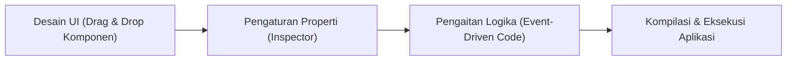

# Pertemuan 1: Pengenalan Pemrograman Visual, Visual Studio, dan .NET

Catatan pembelajaran praktikum Pemrograman Visual pertemuan ke-1 mengenai konsep dasar pemrograman visual, perbandingan dengan paradigma konvensional, lingkungan kerja Microsoft Visual Studio, serta framework .NET.

---

## 1. Konsep Pemrograman Visual (Visual Programming)

### 1.1 Pengertian
**Pemrograman Visual (Visual Programming)** adalah pendekatan pemrograman yang memungkinkan proses perancangan dan pengembangan aplikasi dilakukan melalui manipulasi elemen-elemen grafis (seperti blok, diagram antarmuka, kontrol tombol, dan formulir visual) sebagai representasi dari struktur serta logika program, bukan sekadar menulis baris teks instruksi secara manual dari awal.

### 1.2 Karakteristik Utama
1. **Representasi Visual Logika & Antarmuka**: Logika program disajikan melalui blok, diagram, atau komponen visual yang saling terhubung sesuai dengan alur kerja aplikasi.
2. **Mekanisme Drag-and-Drop**: Komponen antarmuka (UI) maupun blok instruksi dapat ditempatkan ke kanvas kerja dengan menyeret kontrol dari kotak peralatan (*Toolbox*), membuat proses perancangan lebih intuitif dan cepat.
3. **Umpan Balik Visual Langsung (*WYSIWYG - What You See Is What You Get*)**: Perubahan pada ukuran, tata letak, warna, dan susunan elemen form dapat langsung dipantau secara *real-time* tanpa perlu menjalankan proses kompilasi terlebih dahulu.

### 1.3 Tujuan dan Manfaat
- **Mempermudah Pemahaman Konsep**: Sangat ramah bagi pemula untuk memahami konsep alur kontrol, event, objek, dan pemetaan data tanpa langsung terbebani kesalahan sintaksis yang rumit.
- **Visualisasi Alur Program yang Terstruktur**: Memetakan hubungan antar komponen secara jelas.
- **Efisiensi Pengembangan Antarmuka (RAD - Rapid Application Development)**: Mempercepat pembuatan prototipe dan aplikasi GUI bisnis desktop.
- **Meminimalkan Kesalahan Sintaks**: Tata letak dan deklarasi kontrol ditangani secara otomatis oleh IDE (pada file *Designer*).

### 1.4 Keterbatasan
- **Fleksibilitas Terbatas**: Pada perangkat visual murni berbasis blok (seperti Scratch), pembuatan algoritma tingkat rendah yang sangat kompleks memiliki batasan.
- **Kurang Efisien untuk Proyek Sistem Berskala Masif Tanpa UI**: Kurang tepat digunakan untuk pemrosesan *driver*, komputasi kernel, atau *engine* komputasi tinggi yang membutuhkan optimasi memori manual.
- **Ketergantungan pada Platform & IDE**: Membutuhkan lingkungan eksekusi atau runtime tertentu (misal: CLR pada .NET Framework/.NET Runtime).

---

## 2. Platform dan Ekosistem Pemrograman Visual

Secara umum lingkungan pemrograman visual terbagi atas:
1. **Block-Based Visual Programming**:
   - **Scratch**: Ditujukan untuk edukasi logika komputasi anak dan pemula dengan blok warna-warni.
   - **MIT App Inventor**: Pengembangan aplikasi mobile (Android) berbasis blok logika visual.
2. **GUI / RAD (Rapid Application Development) Based Visual Programming**:
   - **Visual Basic (VB.NET) di Visual Studio**: Memadukan perancang visual GUI (*form designer*) dengan kekuatan bahasa pemrograman tingkat tinggi berbasis objek.
   - **JavaFX (Scene Builder)**: Lingkungan visual perancangan antarmuka berbasis XML/FXML untuk bahasa Java.

---

## 3. Ekosistem Pengembangan Microsoft

### 3.1 Visual Studio
**Microsoft Visual Studio** adalah *Integrated Development Environment* (IDE) komprehensif yang dikembangkan oleh Microsoft untuk menulis, mengedit, mendesain antarmuka, mengompilasi, dan melakukan *debugging* aplikasi modern.

Komponen utama antarmuka Visual Studio:
- **Form Designer**: Kanvas grafis untuk meletakkan dan menata komponen visual.
- **Toolbox**: Daftar pustaka komponen siap pakai (Button, Label, TextBox, dsb).
- **Properties Window**: Panel untuk mengatur atribut visual dan perilaku kontrol (Name, Text, BackColor, Font, dll).
- **Solution Explorer**: Struktur direktori berkas proyek, referensi dependensi, dan resource.
- **Code Editor**: Editor penulisan logika pemrosesan kode (Event Handler, Function, Sub).

### 3.2 Visual Basic (.NET)
**Visual Basic** adalah bahasa pemrograman berorientasi objek (*Object-Oriented Programming*) dari Microsoft yang mudah dipahami (*human-readable syntax*), dirancang terintegrasi dengan *Visual Designer* untuk mempermudah pengembangan aplikasi desktop Windows berbasis event (*Event-Driven Programming*).

### 3.3 Platform .NET
**.NET** adalah kerangka kerja (*framework*) pengembangan perangkat lunak modern, lintas platform (*cross-platform*), dan *open-source* yang menyediakan:
- **Common Language Runtime (CLR)**: Mesin eksekusi virtual pengelola memori (*Garbage Collection*), penanganan *exception*, dan keamanan tipe data.
- **Pustaka Kelas Dasar (Base Class Library / BCL)**: Kumpulan fungsi standar untuk manipulasi teks, I/O berkas, koleksi data, jaringan, dan kontrol UI (*Windows Forms*).
- **Dukungan Multi-Bahasa**: Kode VB.NET, C#, dan F# dikompilasi menjadi *Intermediate Language* (CIL) yang sama sehingga dapat saling berinteroperasi.

---

## 4. Hubungan dengan Praktikum Selanjutnya

Pada pertemuan ini difokuskan pada:
1. Menyiapkan instalasi **Visual Studio 2022** dengan workload **.NET Desktop Development** (Windows Forms).
2. Memahami alur kerja *project creation* berbasis template *Windows Forms App (.NET)*.
3. Mengenali pemisahan antara berkas visual UI (`Form.Designer.vb`) dan berkas kode logika (`Form.vb`), yang menjadi pondasi praktikum pertemuan 2 hingga pertemuan 8.
