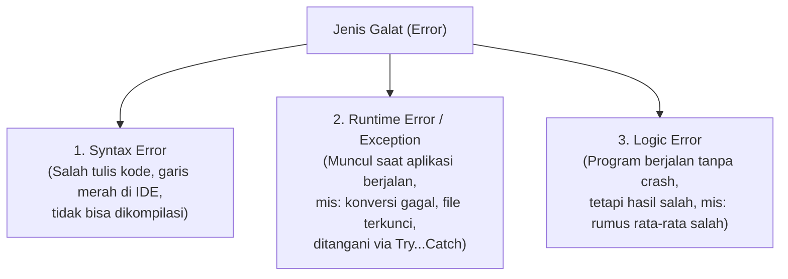
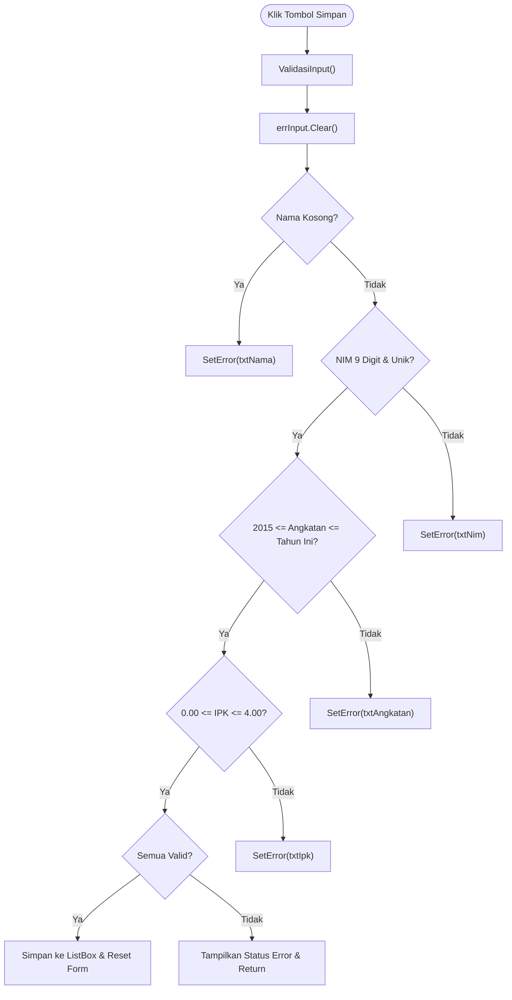

# Pertemuan 7: Validasi Input, Penanganan Error (*Exception Handling*) & *Naming Convention*

Catatan praktikum Pemrograman Visual pertemuan ke-7 mengenai standar penamaan kontrol (*Naming Convention*), klasifikasi jenis galat (*error*), teknik penanganan eksepsi menggunakan `Try...Catch...Finally`, validasi input formulir menggunakan `TryParse`, serta implementasi notifikasi kesalahan antarmuka dengan komponen `ErrorProvider`.

---

## 1. Standar Penamaan Kontrol (*Naming Convention*)

Nama kontrol bawaan seperti `TextBox1`, `Button2`, atau `Label5` menyulitkan pembacaan kode, meningkatkan risiko *bug*, dan menurunkan nilai profesionalitas perangkat lunak.

### 1.1 Pola Standar: `prefix + NamaFungsi`
Aturan penulisan:
- Awalan (*prefix*) berupa **3 huruf kecil** yang menunjukkan jenis kontrol.
- Diikuti oleh nama fungsi dalam gaya **PascalCase** (setiap kata diawali huruf kapital).
- Tanpa spasi, tidak diawali angka, dan konsisten dalam satu bahasa (misal: bahasa Indonesia semua).
- Nilai ini diatur pada properti **`(Name)`** di jendela Properties, **bukan** pada properti `Text`.

| Kontrol | Prefix | Contoh yang Benar | Kontrol | Prefix | Contoh yang Benar |
| :--- | :---: | :--- | :--- | :---: | :--- |
| **Form** | `frm` | `frmPendaftaran` | **CheckBox** | `chk` | `chkSetuju` |
| **Label** | `lbl` | `lblJudul`, `lblStatus` | **RadioButton** | `rdo` | `rdoLakiLaki` |
| **TextBox** | `txt` | `txtNama`, `txtNim` | **GroupBox** | `grp` | `grpDataDiri` |
| **Button** | `btn` | `btnSimpan`, `btnHapus` | **DataGridView** | `dgv` | `dgvMahasiswa` |
| **ComboBox** | `cbo` | `cboJurusan` | **DateTimePicker** | `dtp` | `dtpTanggalLahir` |
| **ListBox** | `lst` | `lstMahasiswa` | **ErrorProvider** | `err` | `errInput` |

---

## 2. Klasifikasi Error dalam Pemrograman



### 2.1 Exception yang Sering Terjadi di .NET
| Tipe Exception | Pemicu Umum |
| :--- | :--- |
| `FormatException` | `Integer.Parse("abc")` atau parsing teks bukan angka. |
| `InvalidCastException` | `CInt("abc")` atau konversi tipe objek yang tidak kompatibel. |
| `OverflowException` | Angka melebihi kapasitas memori tipe data (misal nilai di luar rentang Integer). |
| `DivideByZeroException` | Pembagian bilangan bulat dengan angka 0 (operator `\` atau `Mod`). |
| `IndexOutOfRangeException` | Mengakses indeks array di luar batas kapasitasnya. |
| `NullReferenceException` | Mengakses properti atau method dari objek yang masih bernilai `Nothing` (belum di-`New`). |
| `IOException` | Berkas sedang dibuka oleh program lain (misal CSV di Excel) atau hak akses ditolak. |

---

## 3. Penanganan Eksepsi (*Try...Catch...Finally*)

### 3.1 Alur Kerja Blok Try...Catch
- Blok **`Try`** memuat instruksi yang berpotensi melempar eksepsi.
- Jika terjadi error pada salah satu baris di blok `Try`, sisa baris di dalam `Try` langsung dilewati dan eksekusi melompat ke blok **`Catch`**.
- Blok **`Finally`** selalu dijalankan, baik saat program berjalan normal maupun saat terjadi error. Blok ini wajib digunakan untuk pembersihan sumber daya fisik (*resource cleanup*), seperti menutup file stream (`penulis.Close()`) atau menutup koneksi database.

```vb
Dim penulis As StreamWriter = Nothing
Try
    penulis = New StreamWriter(lokasiFile)
    penulis.WriteLine("Data Tersimpan")
Catch ex As IOException
    MessageBox.Show("Gagal menulis file: " & ex.Message)
Finally
    If penulis IsNot Nothing Then penulis.Close() ' Selalu ditutup
End Try
```

### 3.2 Kapan Menggunakan Try...Catch?
> [!IMPORTANT]
> **Prinsip Emas**: *"Cegah dengan validasi apa yang bisa dicegah. Tangkap dengan Try...Catch apa yang tidak bisa dicegah."*
- **Tepat digunakan**: Operasi I/O eksternal di luar kendali program (membaca/menulis file, koneksi jaringan, request HTTP, database).
- **Tidak tepat digunakan**: Memeriksa input kosong atau format angka dari pengguna (cukup gunakan `If` dan `TryParse`).

---

## 4. Validasi Input: Memilih Alat yang Tepat

### 4.1 Perbandingan `CInt`, `Val`, dan `TryParse`

| Nilai Input | `CInt(teks)` | `Val(teks)` | `Integer.TryParse(...)` |
| :--- | :--- | :--- | :--- |
| `"abc"` | Melempar `InvalidCastException` | `0` (diam-diam salah) | Mengembalikan `False` (aman) |
| `"12abc"` | Melempar `InvalidCastException` | `12` (sangat berbahaya!) | Mengembalikan `False` (aman) |
| `"3.5"` | Dibulatkan sesuai locale | `3` | Mengembalikan `False` (bukan integer) |
| `""` (kosong) | Melempar `InvalidCastException` | `0` | Mengembalikan `False` (aman) |

### 4.2 Jebakan Koma vs Titik (Pemisah Desimal)
Windows berbahasa Indonesia menggunakan koma `,` sebagai pemisah desimal, sedangkan Windows berbahasa Inggris menggunakan titik `.`. Jika pengguna mengetik `"3.75"` di sistem berbahasa Indonesia, `Decimal.TryParse` bawaan dapat menginterpretasikannya sebagai ribuan `375`.
- **Solusi**: Normalisasi teks dengan mengganti koma menjadi titik, lalu baca menggunakan `CultureInfo.InvariantCulture`.

---

## 5. Komponen `ErrorProvider` & Form Pendaftaran

Komponen `ErrorProvider` menampilkan ikon merah di samping kontrol yang tidak valid disertai tooltip pesan kesalahan saat kursor diarahkan. Komponen ini jauh lebih baik dibanding menampilkan popup `MessageBox` secara berulang-ulang.



### 5.1 Implementasi Fungsi Validasi Pembantu (`ModValidasi.vb`)

```vb
Option Strict On
Imports System.Globalization

Public Module ModValidasi
    Public Function Kosong(teks As String) As Boolean
        Return teks.Trim() = ""
    End Function

    Public Function SemuaDigit(teks As String, panjang As Integer) As Boolean
        If teks.Length <> panjang Then Return False
        For Each karakter As Char In teks
            If karakter < "0"c OrElse karakter > "9"c Then Return False
        Next
        Return True
    End Function

    Public Function CobaDesimal(teks As String, ByRef hasil As Decimal) As Boolean
        Dim teksTitik As String = teks.Trim().Replace(",", ".")
        Return Decimal.TryParse(teksTitik, NumberStyles.AllowDecimalPoint,
                                CultureInfo.InvariantCulture, hasil)
    End Function
End Module
```

### 5.2 Implementasi Formulir Pendaftaran (`FrmPendaftaran.vb`)

```vb
Option Strict On
Imports System.IO

Public Class FrmPendaftaran
    Private ReadOnly daftarNim As New List(Of String)
    Private ReadOnly lokasiEkspor As String =
        Path.Combine(Environment.GetFolderPath(Environment.SpecialFolder.MyDocuments), "data-mahasiswa.csv")

    Private Function ValidasiInput() As Boolean
        errInput.Clear()
        Dim valid As Boolean = True

        ' 1. Validasi Wajib Isi
        If Kosong(txtNama.Text) Then
            errInput.SetError(txtNama, "Nama wajib diisi.")
            valid = False
        End If

        ' 2. Validasi Tipe Data & Rentang Angka
        Dim angkatan As Integer
        If Not Integer.TryParse(txtAngkatan.Text, angkatan) OrElse
           angkatan < 2015 OrElse angkatan > Date.Today.Year Then
            errInput.SetError(txtAngkatan, "Angkatan harus angka 2015 s.d. tahun ini.")
            valid = False
        End If

        ' 3. Validasi Format & Keunikan
        If Not SemuaDigit(txtNim.Text, 9) Then
            errInput.SetError(txtNim, "NIM harus 9 digit angka.")
            valid = False
        ElseIf daftarNim.Contains(txtNim.Text) Then
            errInput.SetError(txtNim, "NIM sudah terdaftar.")
            valid = False
        End If

        ' 4. Validasi Pilihan ComboBox
        If cboJurusan.SelectedIndex = -1 Then
            errInput.SetError(cboJurusan, "Pilih salah satu jurusan.")
            valid = False
        End If

        ' 5. Validasi Desimal Invariant & Rentang IPK
        Dim ipk As Decimal
        If Not CobaDesimal(txtIpk.Text, ipk) OrElse ipk < 0D OrElse ipk > 4D Then
            errInput.SetError(txtIpk, "IPK harus angka 0,00 s.d. 4,00.")
            valid = False
        End If

        Return valid
    End Function

    Private Sub btnSimpan_Click(sender As Object, e As EventArgs) Handles btnSimpan.Click
        ' Pola Periksa Dulu, Keluar Jika Gagal
        If Not ValidasiInput() Then
            lblStatus.Text = "Periksa isian yang bertanda merah."
            Return
        End If

        Dim ipk As Decimal
        CobaDesimal(txtIpk.Text, ipk)
        lstMahasiswa.Items.Add(txtNim.Text & " | " & txtNama.Text.Trim() & " | " &
                               cboJurusan.Text & " | " & txtAngkatan.Text & " | " & ipk.ToString("0.00"))
        daftarNim.Add(txtNim.Text)
        lblStatus.Text = "Data " & txtNama.Text.Trim() & " tersimpan."
        BersihkanForm()
    End Sub

    Private Sub btnEkspor_Click(sender As Object, e As EventArgs) Handles btnEkspor.Click
        Dim penulis As StreamWriter = Nothing
        Try
            penulis = New StreamWriter(lokasiEkspor)
            For Each baris As Object In lstMahasiswa.Items
                penulis.WriteLine(baris.ToString().Replace(" | ", ";"))
            Next
            lblStatus.Text = "Data diekspor ke " & lokasiEkspor
        Catch ex As IOException
            MessageBox.Show("File sedang dipakai program lain atau tidak bisa ditulis." & vbCrLf & ex.Message, "Ekspor Gagal")
        Finally
            If penulis IsNot Nothing Then penulis.Close()
        End Try
    End Sub

    Private Sub BersihkanForm()
        txtNim.Clear()
        txtNama.Clear()
        txtAngkatan.Clear()
        txtIpk.Clear()
        cboJurusan.SelectedIndex = -1
        errInput.Clear()
        txtNim.Focus()
    End Sub
End Class
```
