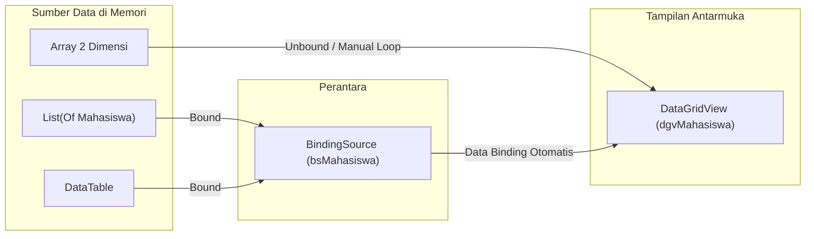

# Pertemuan 8: DataGridView, Array & Koleksi Data (*Data Binding*)

Catatan praktikum Pemrograman Visual pertemuan ke-8 mengenai penyajian data tabular menggunakan kontrol `DataGridView`, pengisian data manual (*unbound*) dari Array 2 Dimensi, pengikatan data terstruktur (*data binding*) menggunakan `List(Of T)` dan `DataTable`, peranan komponen `BindingSource`, perapian tampilan tata letak kolom, serta teknik pencarian (*filtering*).

---

## 1. Pengenalan Kontrol `DataGridView`

Pada pengolahan data multi-kolom yang banyak, kontrol `ListBox` memiliki kelemahan: teks tidak sejajar, sulit dibaca, tidak mendukung pengurutan per kolom, serta data harus dipotong-potong (*string parsing*) saat ingin diambil nilainya.

**`DataGridView`** (berada di Toolbox grup Data dengan standar awalan nama `dgv`) adalah kontrol tabular yang menyajikan data dalam bentuk baris (*rows*) dan kolom (*columns*) menyerupai lembar kerja Excel.



### 1.1 Cara Mengakses Sel
Elemen sel diakses melalui koordinat baris dan kolom berbasis nol (*zero-based*):
```vb
Dim nilaiSel As Object = dgvMahasiswa.Rows(1).Cells(2).Value
' Mengakses baris indeks ke-1, kolom indeks ke-2
```

---

## 2. Dua Pendekatan Pengisian DataGridView

### 2.1 Cara 1: Manual (*Unbound Mode*)
Kolom didefinisikan secara manual pada Designer atau kode, lalu baris ditambahkan satu per satu menggunakan metode `Rows.Add()`.
- Digunakan saat mengisi grid dari **Array 2 Dimensi** menggunakan *nested loop*.
- **Keterbatasan**: Data disalin terputus (perubahan pada array tidak merefleksikan grid), semua data diperlakukan sebagai string, dan kapasitas array kaku.

### 2.2 Cara 2: Pengikatan Data (*Bound Mode via DataSource*)
Grid diikatkan langsung ke objek koleksi data di memori melalui properti `.DataSource`.
- Kolom dibangkitkan secara otomatis berdasarkan atribut properti objek atau skema kolom tabel.
- **Peringatan Kritis**: Jangan mencampur kedua cara ini! Jika grid sudah diikat ke `DataSource`, pemanggilan `Rows.Add()` akan melempar eksepsi `InvalidOperationException`.

---

## 3. Komparasi Sumber Data Tabular

| Karakteristik | Array 2 Dimensi | `List(Of T)` + Class | `DataTable` |
| :--- | :--- | :--- | :--- |
| **Kapasitas Ukuran** | Tetap (*Fixed*) | Dinamis (*Elastis*) | Dinamis (*Elastis*) |
| **Tipe Data per Kolom** | Satu tipe seragam (biasanya String) | Sesuai tipe `Public Property` | Sesuai tipe kolom `DataColumn` |
| **Mekanisme Pengisian** | `dgv.Rows.Add(...)` (Manual) | `dgv.DataSource = ...` | `dgv.DataSource = ...` |
| **Penyusunan Kolom** | Dibuat sendiri manual | Otomatis dari Property | Otomatis dari nama kolom |
| **Pengurutan via Header**| Ya (diurutkan sebagai teks alfabetis) | Tidak aktif secara bawaan | Ya (otomatis sesuai tipe data asli) |
| **Dukungan `BindingSource.Filter`** | Tidak ada | Tidak didukung (diabaikan) | **Ya (Sangat Cepat & Praktis)** |
| **Rekomendasi Kasus** | Data kecil, statis, tanpa manipulasi | Pengolahan berbasis logika OOP murni | Aplikasi bisnis dengan fitur cari & urut |

---

## 4. Peranan `BindingSource` sebagai Perantara

**`BindingSource`** (prefix `bs`, tampil di *component tray*) berfungsi layaknya "petugas perpustakaan" yang berada di antara sumber data dan kontrol tampilan `DataGridView`:
- Menghubungkan sumber data: `bsMahasiswa.DataSource = tabelMahasiswa`.
- Menghubungkan grid ke perantara: `dgvMahasiswa.DataSource = bsMahasiswa`.
- Mengatur pencarian/penyaringan (`bs.Filter`), pengurutan (`bs.Sort`), penambahan item (`bs.Add()`), serta penghitungan baris aktif (`bs.Count`).

---

## 5. Bedah Proyek & Implementasi Kode Praktikum

### 5.1 Pengisian dari Array 2D (`FrmDariArray.vb`)

```vb
Option Strict On

Public Class FrmDariArray
    Private ReadOnly dataMahasiswa(,) As String = {
        {"231712001", "Andi Pratama", "Teknik Informatika", "2023", "3.45"},
        {"231712002", "Sari Wulandari", "Sistem Informasi", "2023", "3.8"},
        {"221712015", "Budi Santoso", "Teknik Informatika", "2022", "3.12"}
    }

    Private Sub btnTampilkan_Click(sender As Object, e As EventArgs) Handles btnTampilkan.Click
        dgvMahasiswa.Rows.Clear()
        ' Nested loop: baris luar (i), kolom dalam (j)
        For i As Integer = 0 To dataMahasiswa.GetUpperBound(0)
            Dim indeksBaris As Integer = dgvMahasiswa.Rows.Add()
            For j As Integer = 0 To dataMahasiswa.GetUpperBound(1)
                dgvMahasiswa.Rows(indeksBaris).Cells(j).Value = dataMahasiswa(i, j)
            Next
        Next
        lblJumlah.Text = "Jumlah data: " & dgvMahasiswa.Rows.Count.ToString()
    End Sub
End Class
```

### 5.2 Pengikatan Objek OOP ke List (`Mahasiswa.vb` & `FrmDariList.vb`)

Konsep **"Satu Baris = Satu Objek"**:
```vb
' Model Kelas Entitas
Public Class Mahasiswa
    Public Property Nim As String
    Public Property Nama As String
    Public Property Jurusan As String
    Public Property Angkatan As Integer
    Public Property Ipk As Decimal

    Public Sub New(nim As String, nama As String, jurusan As String, angkatan As Integer, ipk As Decimal)
        Me.Nim = nim
        Me.Nama = nama
        Me.Jurusan = jurusan
        Me.Angkatan = angkatan
        Me.Ipk = ipk
    End Sub
End Class
```

Pada form antarmuka:
```vb
Private ReadOnly daftarMahasiswa As New List(Of Mahasiswa)

Private Sub FrmDariList_Load(sender As Object, e As EventArgs) Handles MyBase.Load
    daftarMahasiswa.Add(New Mahasiswa("231712001", "Andi Pratama", "Teknik Informatika", 2023, 3.45D))
    ' Data Binding
    bsMahasiswa.DataSource = daftarMahasiswa
    dgvMahasiswa.DataSource = bsMahasiswa
End Sub

Private Sub btnTambah_Click(sender As Object, e As EventArgs) Handles btnTambah.Click
    If Not ValidasiInput() Then Return
    Dim baru As New Mahasiswa(txtNim.Text, txtNama.Text.Trim(), cboJurusan.Text,
                              Integer.Parse(txtAngkatan.Text), ipk)
    ' Tambah data melalui BindingSource agar grid langsung ter-refresh otomatis
    bsMahasiswa.Add(baru)
End Sub
```

### 5.3 Implementasi `DataTable`, Format Kolom & Filter Pencarian (`FrmDataTable.vb`)

```vb
Public Class FrmDataTable
    Private tabelMahasiswa As DataTable

    Private Sub FrmDataTable_Load(sender As Object, e As EventArgs) Handles MyBase.Load
        tabelMahasiswa = BuatTabelMahasiswa()
        bsMahasiswa.DataSource = tabelMahasiswa
        dgvMahasiswa.DataSource = bsMahasiswa
        PerbaruiJumlah()
    End Sub

    ' Merapikan judul, perataan teks, dan format angka desimal
    Private Sub AturKolom()
        dgvMahasiswa.Columns("Nim").HeaderText = "NIM"
        dgvMahasiswa.Columns("Ipk").HeaderText = "IPK"
        dgvMahasiswa.Columns("Ipk").DefaultCellStyle.Format = "N2" ' Format dua digit desimal (misal 3.80)
        dgvMahasiswa.Columns("Ipk").DefaultCellStyle.Alignment = DataGridViewContentAlignment.MiddleRight
        dgvMahasiswa.Columns("Angkatan").DefaultCellStyle.Alignment = DataGridViewContentAlignment.MiddleCenter
        dgvMahasiswa.Columns("Nama").FillWeight = 200
        dgvMahasiswa.AutoSizeColumnsMode = DataGridViewAutoSizeColumnsMode.Fill
    End Sub

    ' Fitur Pencarian Real-Time di Memori (Bukan Kueri SQL Server)
    Private Sub txtCari_TextChanged(sender As Object, e As EventArgs) Handles txtCari.TextChanged
        Dim kata As String = AmankanTeksFilter(txtCari.Text.Trim())
        If kata = "" Then
            bsMahasiswa.RemoveFilter()
        Else
            bsMahasiswa.Filter = "Nama LIKE '%" & kata & "%' OR Nim LIKE '%" & kata & "%'"
        End If
        PerbaruiJumlah()
    End Sub
End Class
```

---

## 6. Ringkasan Kesalahan Umum yang Harus Dihindari
1. **Memanggil `Rows.Add()` pada Grid yang terikat `DataSource`**: Memicu `InvalidOperationException`.
2. **Mengatur Properti Kolom Sebelum `DataSource` Diisi**: Kolom baru terwujud setelah `DataSource` diikatkan, sehingga memanggil `Columns("Nim")` sebelumnya akan menyebabkan `NullReferenceException`.
3. **Menambahkan Data ke `daftarMahasiswa.Add()` tanpa Melibatkan `BindingSource`**: Data bertambah di memori namun antarmuka grid tidak ter-refresh. Solusi: Gunakan `bsMahasiswa.Add()` atau panggil `bsMahasiswa.ResetBindings(False)`.
4. **Pencarian Karakter Khusus Tanpa Sanitasi**: Jika pengguna mencari nama yang memuat tanda petik satu (seperti *"Ma'ruf"*), ekspresi `Filter` akan rusak dan memicu *crash*. Gunakan fungsi sanitasi untuk menggandakan tanda petik (`'` menjadi `''`).
